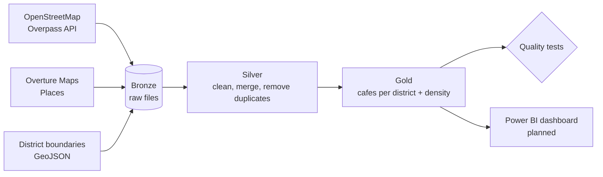

# Riyadh Coffee Map — Data Pipeline

A small data engineering project. It collects cafes in Riyadh from two open sources, cleans and merges them, assigns each cafe to a district, and measures how many cafes each district has.

The goal: answer *"Which districts have many cafes, and which ones are less crowded?"*

## Architecture



| Layer | What happens |
|---|---|
| **Bronze** | Raw files, never edited. Every download is also saved in `data/bronze/archive/<date>/`. |
| **Silver** | Merge both sources, remove cafes outside Riyadh, remove low-confidence and nameless rows, normalize Arabic names, remove duplicates. |
| **Gold** | Point-in-polygon join (cafe → district), then count and density per district. |
| **Quality tests** | 13 automatic checks plus a comparison with the previous run. The run fails if a check fails. |

## Data sources

| Source | Used for | License |
|---|---|---|
| OpenStreetMap (Overpass API) | Cafes | ODbL — © OpenStreetMap contributors |
| Overture Maps — Places | Cafes | CDLA Permissive 2.0 |
| Saudi districts GeoJSON (community dataset, `yasseralsamman/saudi-national-address`) | District boundaries | CC0 (as stated by the project) |

## Results (latest run)

- OSM: 376 cafes. Overture: 3,358 cafe rows.
- After cleaning and merging (Silver): **3,324** cafes.
- After district assignment (Gold): **3,270** cafes in Riyadh city, **143** districts with cafes.
- 99.4% of cafes were matched to a district.

| District | Cafes | Cafes per km² |
|---|---|---|
| Al Olaya | 179 | 16.4 |
| Al Aqeeq | 108 | 13.4 |
| Al Sulaimaniyah | 91 | 11.3 |
| Al Malqa | 89 | 4.1 |
| Hiteen | 84 | 4.6 |

Count and density give different stories. For example, Al Malqa has 89 cafes but a low density (4.1 per km²) because it is a large district, while Al Woroud has 51 cafes and a density of 11.4 per km².

## How to run

```
pip install requests pandas numpy overturemaps

python run_pipeline.py                 # Silver + Gold + tests, using the existing Bronze files
python run_pipeline.py --extract       # also re-download OSM and Overture first
```

Outputs:

- `data/silver/cafes_silver.csv`
- `data/gold/cafes_gold.csv`, `data/gold/district_summary.csv`
- `data/quality/test_results.json`
- `logs/pipeline_<date>.log`

The exit code is `0` if everything passed, `1` if a quality test failed, and `2` if the pipeline crashed.

## Data quality tests

- **Silver:** enough rows, unique `cafe_id`, no empty coordinates or names, all points inside the Riyadh box, no exact duplicates, confidence between 0 and 1.
- **Gold:** enough rows, at least 98% of cafes matched to a district, every cafe has a `district_id`, district totals match the cafe count, area and density are valid.
- **Regression:** the run fails if Silver or Gold lose more than 20% of rows compared with the last healthy run.

## Decisions I made

- **Confidence ≥ 0.5** for Overture rows. This threshold is my judgment, not a rule from the source.
- **Duplicates:** two places are the same if they are within 75 m and their names are similar.
- **Non-cafe categories** (internet cafes, coffee supplies shops, cafeterias) are removed in Gold.
- **Airport polygon:** in the district file, the King Khalid International Airport polygon covers a very large area (about 250 km²) and 102 cafes. It is not a real residential district, so those cafes stay on the map but are excluded from the district ranking.

## Limitations

- The numbers show places registered in OpenStreetMap and Overture. Some places may be closed, and some real cafes may be missing.
- Only 41 cafes matched between the two sources. Some duplicates with different names (Arabic vs English) may remain.
- Density uses the full district area, including empty land.
- District boundaries come from a community dataset. I checked them only by looking at the results, not against an official source.
- The extraction step (`--extract`) depends on free public servers, which can be slow or unavailable.

## Roadmap

- [ ] Weekly scheduled run
- [ ] Move Silver and Gold to Databricks (Delta tables)
- [ ] Power BI dashboard in Arabic (3 pages: overview, density, data notes)
- [ ] Mark chain cafes vs independent cafes
